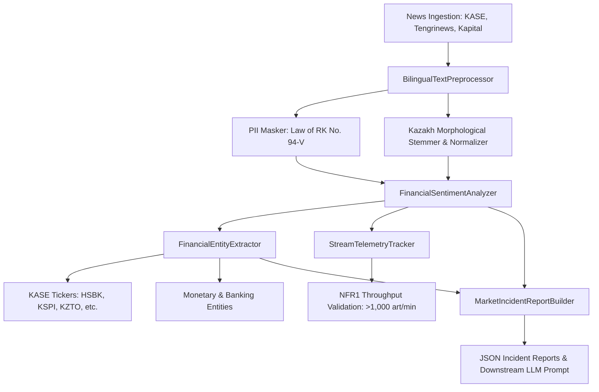

# Kazakhstani NLP Financial News System (Core Engine)

[](https://github.com/solodancer235-star/kaz-fin-nlp-core/actions/workflows/ci.yml)
[](https://github.com/solodancer235-star/kaz-fin-nlp-core)
[](https://www.python.org/downloads/)
[](https://github.com/psf/black)
[](https://mypy-lang.org/)
[](LICENSE)

A high-performance, bilingual (**Kazakh & Russian**) natural language processing, financial sentiment classification, and regulatory compliance computational module designed for Central Asian enterprise financial systems, news wires (Tengrinews, Kapital.kz, KASE), and automated trading desks.

---

## 1. Architectural Overview



### Core Components
1. **`BilingualTextPreprocessor`**:
   - Automated detection of Kazakh vs Russian vs Mixed Cyrillic content.
   - Suffix stripping for Kazakh agglutinative morphology (plurals, case declensions, possessive markers).
   - Automated scrubbing of 12-digit Individual Identification Numbers (IIN), Kazakh phone numbers, and IBANs in strict compliance with the **Law of the Republic of Kazakhstan "On Personal Data and Their Protection" (No. 94-V)**.
2. **`FinancialSentimentAnalyzer`**:
   - Specialized bilingual lexicon for Central Asian financial and macroeconomic discourse.
   - Directional sentiment polarity scoring $[-1.0, +1.0]$, confidence estimation, and automated market urgency stratification (`CRITICAL`, `HIGH`, `MEDIUM`, `LOW`).
3. **`FinancialEntityExtractor`**:
   - KASE stock tickers (`KZTO`, `HSBK`, `KSPI`, `CCBN`, `KMGZ`, `KEGC`, `KZAP`, `KZTK`).
   - Regional banking institutions (Kaspi.kz, Halyk Bank, BCC, Freedom Finance, Jusan Bank).
   - Regulatory entities (National Bank of Kazakhstan / NBK, ARDFM).
   - Multi-currency and monetary scale extraction (KZT, USD, EUR, RUB).
4. **`StreamTelemetryTracker`**:
   - Thread-safe sliding window tracking inference latency (ms), rolling throughput, P95/P99 latency, and real-time validation of **NFR1** (>1,000 articles/min).
5. **`MarketIncidentReportBuilder`**:
   - Pydantic v2 schemas synthesizing high-urgency market events into structured JSON payloads and prompt templates for upstream Large Language Models (KazLLM / GPT-4o).

---

## 2. Installation

### Requirements
- Python 3.10, 3.11, or 3.12
- Linux, macOS, or Windows

### Clone and Install
```bash
git clone https://github.com/solodancer235-star/kaz-fin-nlp-core.git
cd kaz-fin-nlp-core

# Create virtual environment
python -m venv .venv
source .venv/bin/activate  # On Windows: .venv\Scripts\activate

# Install package with development dependencies
pip install -e ".[dev]"
```

---

## 3. Command-Line Interface (CLI)

The package provides a unified CLI tool: `kaz-fin-nlp`.

### 1. High-Throughput Processing Benchmark
Verify computational module throughput and latency against Assignment 2 NFR1 (>1,000 articles/min):
```bash
kaz-fin-nlp benchmark --iterations 500
```

### 2. Single Document Analysis
Analyze any news headline or article snippet in Russian or Kazakh:
```bash
kaz-fin-nlp analyze --text "KASE: Kaspi.kz акциялары 12% өсім көрсетіп, таза табыс 450 млрд теңгеге жетті."
```

### 3. Real-Time Streaming HUD
Simulate streaming news wire feeds with formatted console heads-up display:
```bash
kaz-fin-nlp stream-demo --articles 20 --delay 0.1
```

### 4. Export LLM Incident Report
Generate a standardized JSON incident alert for downstream AI ingestion:
```bash
kaz-fin-nlp export-report --output sample_incident.json
```

---

## 4. Python API Quickstart

```python
from kaz_fin_nlp import (
    BilingualTextPreprocessor,
    FinancialSentimentAnalyzer,
    FinancialEntityExtractor,
    MarketIncidentReportBuilder,
    StreamTelemetryTracker,
)

# 1. Initialize pipeline components
preprocessor = BilingualTextPreprocessor()
analyzer = FinancialSentimentAnalyzer()
extractor = FinancialEntityExtractor()
builder = MarketIncidentReportBuilder()

# 2. Process incoming bilingual news article
raw_news = (
    "Народный банк Казахстана (HSBK) объявил о рекордном росте чистой прибыли "
    "до 120 млрд тенге. Контакт аналитика: +7 (701) 555-12-34."
)

# Step A: Preprocess and sanitize PII
doc = preprocessor.process(raw_news)
print(f"Language: {doc.detected_language.value}")
print(f"Sanitized: {doc.cleaned_text}")

# Step B: Sentiment and Entity Extraction
sentiment = analyzer.analyze(doc.stems, raw_text=doc.cleaned_text)
entities = extractor.extract_entities(raw_news)

# Step C: Synthesize Market Incident Report
report = builder.build_report(
    headline=raw_news,
    source="KAPITAL_KZ",
    language=doc.detected_language.value,
    sentiment=sentiment,
    entities=entities,
)

print(f"Sentiment: {sentiment.label.value} (Polarity: {sentiment.polarity})")
print(f"Urgency: {sentiment.urgency.value}")
print(f"Actions: {report.recommended_actions}")
```

---

## 5. Development and Quality Assurance

This repository enforces strict CI/CD pipelines and scientific software engineering practices:

```bash
# Run test suite with coverage
pytest --cov=kaz_fin_nlp --cov-report=term-missing

# Code formatting
black kaz_fin_nlp tests

# Linting
flake8 kaz_fin_nlp tests --max-line-length=88 --extend-ignore=E203,W503

# Static type checking
mypy kaz_fin_nlp

# SAST security audit
bandit -r kaz_fin_nlp
```

---

## 6. License

This project is licensed under the MIT License - see the [LICENSE](LICENSE) file for details.
